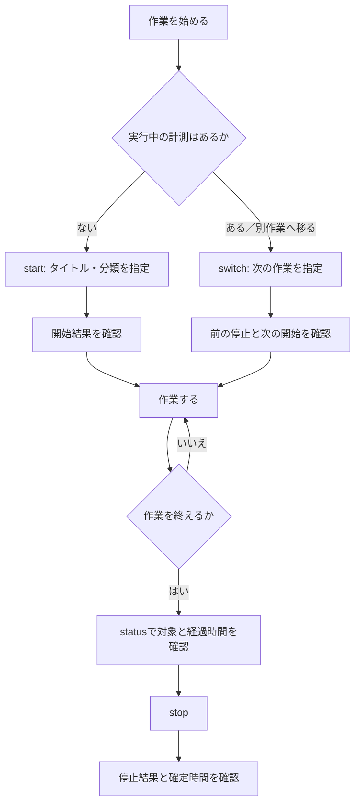
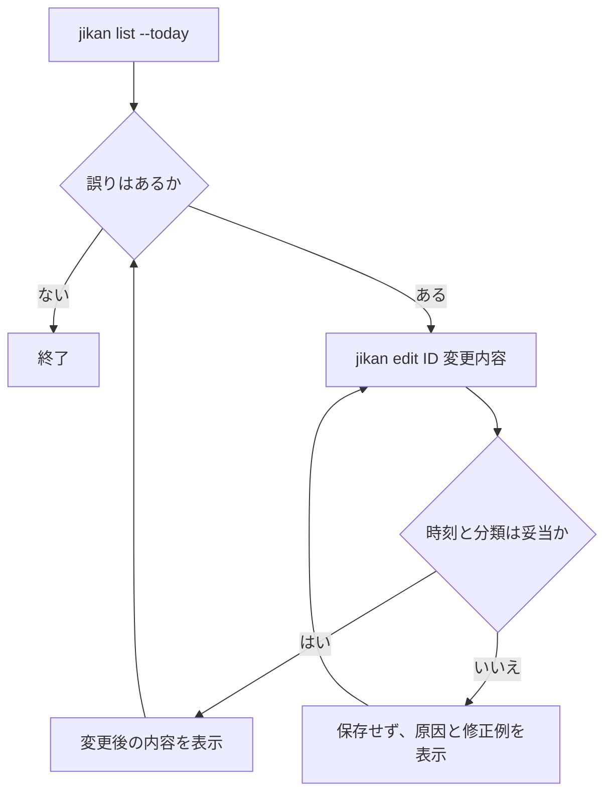

# Jikan ユーザーフローと機能設計

## 1. この成果物の位置づけ

Jikan は CLI なので、画面遷移を再現する動く画面モックは作らない。代わりに、この文書をコマンド会話プロトタイプとする。利用者が打つコマンドと、その直後に読む出力を並べ、実装前に操作の速さ・分かりやすさ・エラーからの回復を確認する。

対象となる課題と受け入れ条件は [UI/UX 再設計：課題定義と要求分析](ui-ux-requirements.md) を正とする。本書では、提供するユーザー体験を完結させる機能、操作の詳細、実装順を決める。

## 2. 提供する体験と対象範囲

### 提供する価値

利用者が、日中の作業開始・切替・終了をスムーズに記録でき、終業時にその日の記録を確認・修正し、月次に案件・タグごとの時間を確認または取り出せることを検証する。

計測の正確さと、その記録を振り返りに使えることを、ひと続きの完成体験として提供する。月次集計・CSV出力は、記録を実務に使える状態にするために含める。

### 対象範囲

| 区分 | 含めるもの | 理由 |
| --- | --- | --- |
| 提供する機能 | 初期化、プロジェクト・タグの登録、名前と Tab 補完による指定、開始、状態確認、停止、切替、一覧、編集、期間集計、CSV 出力 | 日々の「記録する → 確認して直す」と、月次の「集計して使う」を完結させる一連の体験 |
| 今回は扱わない | GUI、クラウド同期、チーム共有、自動分類 | ローカルCLIでの入力品質・操作摩擦という仮説から外れる |

## 3. ストーリーマップと実装順

横方向は利用者の行動の流れ、縦方向は実装順である。上段の主要フローを先に完成させた後、操作効率を高める機能を追加する。いずれもローカルCLIの対象範囲に含まれる。

| 実装順 | 準備する | 作業を始める | 別作業に移る | 作業を終える | 終業時に見直す | 月次に振り返る |
| --- | --- | --- | --- | --- | --- | --- |
| **第1段階：正確に記録する** | `init`、プロジェクト/タグ登録、補完の有効化 | 名前でプロジェクト・タグを指定して `start` | `switch` で停止と開始を原子的に行う | `status` または `timer` で確認し `stop` | — | — |
| **第2段階：記録を確認・修正する** | — | — | — | — | `list`、`edit`、期間・分類での絞り込み | — |
| **第3段階：記録を活用する** | — | — | — | — | — | `report` と `export` |
| **第4段階：操作効率を高める** | プロジェクトのアーカイブ、候補の絞り込み | 最近使った分類の提案 | 直前の分類を引き継ぐ | 停止忘れの検知 | 一括編集 | 出力形式のカスタマイズ、請求書連携 |

### ユーザーストーリーと機能の対応

| ユーザーストーリー | 提供する操作 | 完了の判断 |
| --- | --- | --- |
| US-01 作業開始 | `start --title --project --tag`、Tab 補完 | 分類付きの実行中エントリーが1件だけできる |
| US-02 切替 | `switch --title --project --tag` | 前のエントリーが終了し、新しいものだけが実行中になる |
| US-03 停止 | `status`、`timer`、`stop` | 何を計測中かと確定時間を確認できる |
| US-04 修正 | `list --today`、`edit` | 誤った時間・分類を安全に直せる |
| US-05 集計 | `report --from --to`、`export --from --to --format csv` | 指定期間の総計・分類別内訳を確認し、同じ対象をCSVで取り出せる |

## 4. タスクフロー

### 4.1 日中の主フロー



### 4.2 終業時の修正フロー



### 4.3 例外フロー：すでに計測中に `start` した場合

1. `start` は新しいエントリーを作らない。
2. 実行中のタイトル、開始時刻、プロジェクトを表示する。
3. 利用者には `jikan switch ...` または `jikan stop` の次の操作を提示する。
4. 利用者が意図していた作業への切替を、コマンドを打ち直して行う。

自動で切り替えない。`start` の意図は開始であり、実行中の作業を終了してよいという意思表示ではないためである。

## 5. コマンド会話プロトタイプ

以下の固定日時・IDは出力レイアウトを検討するための例であり、実際には現在時刻と保存済みデータを表示する。成功メッセージは色だけに依存しない。

### シナリオA：分類して計測を開始する

プロジェクト・タグは名前で指定する。`--tag` は繰り返せる。

```console
$ jikan start --title "ログイン画面の実装" --project client-web --tag development --tag frontend
Started #42
  Title:   ログイン画面の実装
  Project: client-web
  Tags:    development, frontend
  Started: 2026-10-21 09:00 JST
```

出力だけで「何を」「どの分類で」「いつから」記録しているかを確認できる。説明文は開始時には必須にしない。日常の入力を遅くするためである。

### シナリオB：Tab 補完で分類を選ぶ

補完はシェルの機能であり、初回だけ有効化が必要である。Zsh の例を示す。

```console
$ jikan --install-completion zsh
Shell completion installed. Restart your shell or run: source ~/.zshrc

$ jikan start --title "ログイン画面の実装" --project cli<Tab>
client-web  client-mobile

$ jikan start --title "ログイン画面の実装" --project client-web --tag f<Tab>
frontend
```

候補はローカルDBの登録済みプロジェクト・タグから動的に返す。候補が多い場合は、入力済みの接頭辞で絞る。補完が未設定でも、完全な名前を入力すればコマンドは実行できる。

### シナリオC：作業を切り替える

```console
$ jikan switch --title "PR #43 のレビュー" --project jikan --tag review
Stopped #42  ログイン画面の実装  00h 42m 18s
Started #43
  Title:   PR #43 のレビュー
  Project: jikan
  Tags:    review
  Started: 2026-10-21 09:42 JST
```

このコマンドは「次の作業へ移る」という意図を表す。新しい入力の検証・保存に失敗した場合は、#42 を停止しない。

### シナリオD：終了前に確認して停止する

```console
$ jikan status
Running #43
  Title:   PR #43 のレビュー
  Project: jikan
  Tags:    review
  Started: 2026-10-21 09:42 JST
  Elapsed: 01h 18m 06s

$ jikan stop
Stopped #43  PR #43 のレビュー
  Ended:    2026-10-21 11:00 JST
  Duration: 01h 18m 21s
```

### シナリオE：作業中はライブタイマーを表示する

`timer` は、作業中に別のターミナル枠で開いておく表示専用のコマンドである。`status` と異なり、終了せずに経過時間を更新する。`Ctrl+C` は表示を閉じる操作であり、計測の停止ではない。

```console
$ jikan timer
╭──────────────────────────── Jikan timer ────────────────────────────╮
│                             CURRENT TASK                             │
│                          PR #43 のレビュー                           │
│                                                                       │
│      ┏━━━┓ ┏━━━┓     ┏━━━┓ ┏━━━┓     ┏━━━┓ ┏━━━┓                     │
│      ┃   ┃ ┃   ┃  ●  ┃   ┃ ┃   ┃  ●  ┃   ┃ ┃   ┃                     │
│      ┗━━━┛ ┗━━━┛     ┗━━━┛ ┗━━━┛     ┗━━━┛ ┗━━━┛                     │
│                            01:18:06                                  │
│                                                                       │
│                   Press Ctrl+C to close this view                    │
╰───────────────────────────────────────────────────────────────────────╯
```

実装では `01:18:06` 自体を 5 行以上のブロック文字で描画する。この例では紙面の都合で数字を省略している。表示は少なくとも 1 秒ごとに更新し、ターミナルが狭い場合もタスク名より経過時間を優先して残す。

### シナリオF：誤った記録を探して直す

`list` は当日を既定にする。履歴全体を毎回表示せず、終業時の見直しに必要な量に絞るためである。

```console
$ jikan list --today
Date        ID  Status  Duration   Title                 Project     Tags
2026-10-21  42  Done    00h 42m    ログイン画面の実装   client-web  development, frontend
2026-10-21  43  Done    01h 18m    PR #43 のレビュー    jikan       review
Total: 02h 00m

$ jikan edit 42 --remove-tag frontend --tag backend
Updated #42
  Tags: development, backend
```

タグの追加は `--tag`、削除は `--remove-tag` とする。同じ `--tag` を `start` と `edit` で使い、覚える概念を増やさない。

### シナリオG：月次の内訳を確認し、CSVで取り出す

期間は設定済みタイムゾーンで解釈する。プロジェクト未設定・タグ未設定の記録も集計から除外しない。タグは複数付与できるため、タグ別内訳は総計と加算一致しない場合がある。

```console
$ jikan report --from 2026-10-01 --to 2026-10-31
Period:   2026-10-01 00:00 to 2026-10-31 23:59 (Asia/Tokyo)
Total:    18h 30m

By project (adds to Total)
  client-web  12h 00m
  jikan        5h 30m
  Unassigned   1h 00m

By tag (overlapping; does not add to Total)
  development  9h 00m
  frontend     2h 00m
  review       5h 30m
  Unassigned   4h 00m

$ jikan export --from 2026-10-01 --to 2026-10-31 --format csv
id,start_at,end_at,duration,title,project,tags
42,2026-10-21T09:00:00+09:00,2026-10-21T09:42:18+09:00,00:42:18,ログイン画面の実装,client-web,"development,frontend"
```

プロジェクト別内訳は互いに排他的であり、合計は `Total` と一致する。タグ別内訳は1件の時間を付与済みの各タグへ計上するため、複数タグの記録がある場合は合計を `Total` と比較しない。

`export` は `report` と同じ期間・分類条件を受け取る。対象データがない場合もエラーにはせず、対象条件と空であることを表示する。

### シナリオH：迷ったときのエラーと回復

```console
$ jikan start --title "障害調査" --project client-web
Cannot start a new timer: #43 is already running.
  Running: PR #43 のレビュー (since 2026-10-21 09:42 JST)
  Next:    jikan switch --title "障害調査" --project client-web
  Or stop: jikan stop
```

エラーは原因だけで終えず、次に打てるコマンドを1つ以上示す。このケースではデータを変更しない。

## 6. コマンド契約

| コマンド | 責務 | 主な入力 | 正常時に必ず返す情報 |
| --- | --- | --- | --- |
| `jikan init` | ローカルDBを初期化する | なし | データ保存先、次に行うセットアップ |
| `jikan project add` / `jikan tag add` | 分類候補を登録する | 名前 | 作成した名前 |
| `jikan start` | 新しい計測を始める | title、project名、tag名（複数可） | ID、タイトル、分類、開始時刻 |
| `jikan switch` | 実行中を停止し次を開始する | `start` と同じ | 停止内容、開始内容 |
| `jikan status` | 実行中の計測を確認する | なし | タイトル、分類、開始時刻、経過時間 |
| `jikan timer` | 実行中のタスクと経過時間をライブ表示する | なし | タスク名、大きな `HH:MM:SS`、終了方法 |
| `jikan stop` | 実行中の計測を終える | なし | タイトル、終了時刻、確定時間 |
| `jikan list [--from DATE --to DATE] [--project NAME] [--tag NAME]` | 記録を見直す | 期間、任意の分類条件 | 状態、行ごとの所要時間、期間合計 |
| `jikan edit ID` | 記録を修正する | 時刻・分類・タイトル | 変更後の主要項目 |
| `jikan report --from DATE --to DATE` | 期間の時間内訳を確認する | 期間、任意の分類条件 | 対象期間、総計、プロジェクト別・タグ別合計 |
| `jikan export --from DATE --to DATE --format csv` | 集計・記録を外部で使う | 期間、CSV形式、任意の分類条件 | 機械可読なCSVデータ |

`--project` は名前を受けるオプションとする。既存の `start --id` は、実装時に非推奨の互換オプション `--project-id` に移し、名称の意味を明確にする。プロジェクト名・タグ名が重複しないことは、既存のデータモデルの一意制約を維持することで担保する。

## 7. UX確認の進め方

この文書のシナリオを、ターミナルに慣れた利用者5人程度に読んでもらい、実装前・実装後で同じタスクを試す。

| タスク | 観察すること | 合格の目安 |
| --- | --- | --- |
| 新しい作業を分類付きで開始する | プロジェクト・タグの探し方、入力の迷い | 補完または名前入力で1分以内に開始できる |
| 割り込みへ切り替える | `switch` の意味を理解できるか | stop/startを探さず `switch` を選べる |
| 作業中の計測を表示する | 大きな時間表示と `Ctrl+C` の意味を理解できるか | 現在のタスクと経過時間を読め、計測を止めずに表示を閉じられる |
| 終業時に停止する | `status` を挟む理由、結果の理解 | 対象を誤らず停止できる |
| タグを修正する | `list` からIDと編集方法を特定できるか | 1回の修正で期待するタグになる |
| 月次の作業時間を確認・出力する | 期間の指定、集計値とCSVの対応を理解できるか | 目的の月の内訳を確認し、同じ条件でCSVを出力できる |
| すでに実行中に開始する | エラー後に取る行動 | 案内された次のコマンドで回復できる |

記録する指標は、各タスクの完了可否、完了時間、詰まった箇所、発話された疑問、誤操作である。特に `switch` が「停止と開始の言い換え」ではなく「対象の切替」と理解されるかを検証する。

## 8. 実装前に確定する判断

1. `list` の既定範囲を「当日」にするか、全件表示を維持して `--today` を推奨するか。
2. `edit` のタグ追加を `--tag` に統一するか、既存互換の `--add-tag` を残すか。
3. 補完の初期設定を `--install-completion` で案内するか、Typer標準の補完コマンドに委ねるか。
4. 名称変更時に、既存の `start --id` をいつ削除するか。

これらは実装上の都合ではなく、コマンドを覚える負担と既存利用者の移行負担のトレードオフとして決める。
