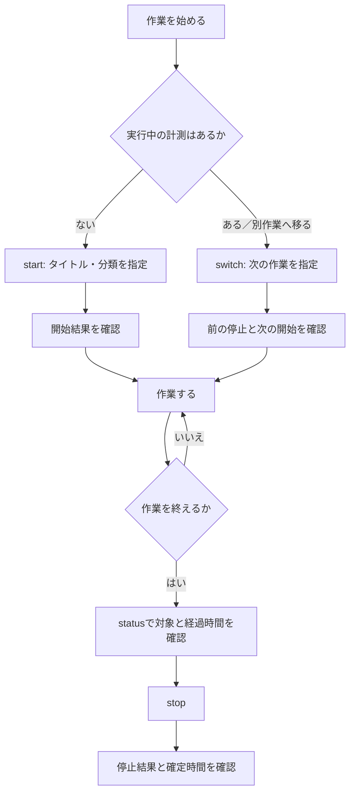
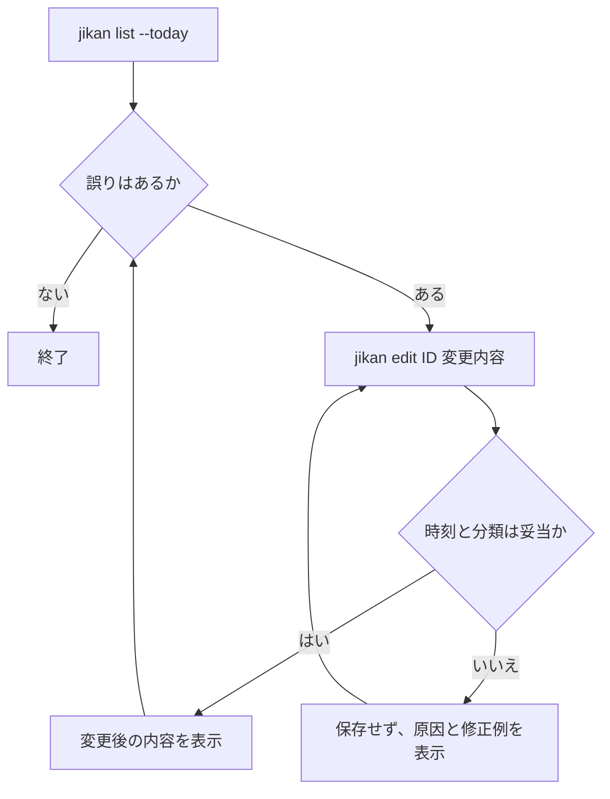

# Jikan ユーザーフローとMVP設計

## 1. この成果物の位置づけ

Jikan は CLI なので、画面遷移を再現する動く画面モックは作らない。代わりに、この文書を**コマンド会話プロトタイプ**とする。利用者が打つコマンドと、その直後に読む出力を並べ、実装前に操作の速さ・分かりやすさ・エラーからの回復を確認する。

対象となる課題と受け入れ条件は [UI/UX 再設計：課題定義と要求分析](ui-ux-requirements.md) を正とする。本書では、そこから MVP に入れる範囲と操作の詳細を決める。

## 2. MVP の判断

### MVP で検証する価値

利用者が、日中の作業開始・切替・終了を止めずに記録でき、終業時にその日の記録を確認・修正できることを検証する。

計測が正確に続くことが先決なので、月次集計・CSV 出力は MVP の対象外とする。これらは記録が十分に蓄積されてから価値が生まれるため、MVP 後に実装する。

### スコープ

| 区分 | 含めるもの | 理由 |
| --- | --- | --- |
| MVP | 初期化、プロジェクト・タグの登録、名前と Tab 補完による指定、開始、状態確認、停止、切替、当日の一覧、編集 | 日々の「記録する → 確認して直す」を完結させる最小の一連の体験 |
| MVP 後 | 期間横断の `report`、`export`、請求向け集計 | 記録フローそのものを検証するのに必須ではない |
| 今回は扱わない | GUI、クラウド同期、チーム共有、自動分類 | ローカルCLIでの入力品質・操作摩擦という仮説から外れる |

## 3. ストーリーマップ

横方向は利用者の行動の流れ、縦方向はリリース優先度である。上段ほど先に提供する。

| リリース | 準備する | 作業を始める | 別作業に移る | 作業を終える | 終業時に見直す | 月次に振り返る |
| --- | --- | --- | --- | --- | --- | --- |
| **MVP** | `init`、プロジェクト/タグ登録、補完の有効化 | 名前でプロジェクト・タグを指定して `start` | `switch` で停止と開始を原子的に行う | `status` で確認し `stop` | 当日の `list`、`edit` | — |
| **次点** | プロジェクトのアーカイブ、候補の絞り込み | 最近使った分類の提案 | 直前の分類を引き継ぐ | 停止忘れの検知 | 期間・分類で `list` を絞り込む | `report` と `export` |
| **将来** | インポート、共有設定 | 定型作業のショートカット | 休憩・再開 | リマインダー | 一括編集 | 請求書連携、可視化 |

### MVP のユーザーストーリーへの対応

| ユーザーストーリー | MVPで提供する操作 | 完了の判断 |
| --- | --- | --- |
| US-01 作業開始 | `start --title --project --tag`、Tab 補完 | 分類付きの実行中エントリーが1件だけできる |
| US-02 切替 | `switch --title --project --tag` | 前のエントリーが終了し、新しいものだけが実行中になる |
| US-03 停止 | `status`、`stop` | 何を計測中かと確定時間を確認できる |
| US-04 修正 | `list --today`、`edit` | 誤った時間・分類を安全に直せる |
| US-05 集計 | MVP後の `report`、`export` | 対象外。MVPで蓄積したデータを使って検証する |

## 4. タスクフロー

### 4.1 日中の主フロー



### 4.2 終業時の修正フロー



### 4.3 例外フロー：すでに計測中に `start` した場合

1. `start` は新しいエントリーを作らない。
2. 実行中のタイトル、開始時刻、プロジェクトを表示する。
3. 利用者には `jikan switch ...` または `jikan stop` の次の操作を提示する。
4. 利用者が意図していた作業への切替を、コマンドを打ち直して行う。

自動で切り替えない。`start` の意図は開始であり、実行中の作業を終了してよいという意思表示ではないためである。

## 5. コマンド会話プロトタイプ

以下の固定日時・IDは出力レイアウトを検討するための例であり、実際には現在時刻と保存済みデータを表示する。成功メッセージは色だけに依存しない。

### シナリオA：分類して計測を開始する

プロジェクト・タグは名前で指定する。`--tag` は繰り返せる。

```console
$ jikan start --title "ログイン画面の実装" --project client-web --tag development --tag frontend
Started #42
  Title:   ログイン画面の実装
  Project: client-web
  Tags:    development, frontend
  Started: 2026-10-21 09:00 JST
```

出力だけで「何を」「どの分類で」「いつから」記録しているかを確認できる。説明文は開始時には必須にしない。日常の入力を遅くするためである。

### シナリオB：Tab 補完で分類を選ぶ

補完はシェルの機能であり、初回だけ有効化が必要である。Zsh の例を示す。

```console
$ jikan --install-completion zsh
Shell completion installed. Restart your shell or run: source ~/.zshrc

$ jikan start --title "ログイン画面の実装" --project cli<Tab>
client-web  client-mobile

$ jikan start --title "ログイン画面の実装" --project client-web --tag f<Tab>
frontend
```

候補はローカルDBの登録済みプロジェクト・タグから動的に返す。候補が多い場合は、入力済みの接頭辞で絞る。補完が未設定でも、完全な名前を入力すればコマンドは実行できる。

### シナリオC：作業を切り替える

```console
$ jikan switch --title "PR #43 のレビュー" --project jikan --tag review
Stopped #42  ログイン画面の実装  00h 42m 18s
Started #43
  Title:   PR #43 のレビュー
  Project: jikan
  Tags:    review
  Started: 2026-10-21 09:42 JST
```

このコマンドは「次の作業へ移る」という意図を表す。新しい入力の検証・保存に失敗した場合は、#42 を停止しない。

### シナリオD：終了前に確認して停止する

```console
$ jikan status
Running #43
  Title:   PR #43 のレビュー
  Project: jikan
  Tags:    review
  Started: 2026-10-21 09:42 JST
  Elapsed: 01h 18m 06s

$ jikan stop
Stopped #43  PR #43 のレビュー
  Ended:    2026-10-21 11:00 JST
  Duration: 01h 18m 21s
```

### シナリオE：誤った記録を探して直す

`list` はMVPでは当日を既定にする。履歴全体を毎回表示せず、終業時の見直しに必要な量に絞るためである。

```console
$ jikan list --today
Date        ID  Duration   Title                 Project     Tags
2026-10-21  42  00h 42m    ログイン画面の実装   client-web  development, frontend
2026-10-21  43  01h 18m    PR #43 のレビュー    jikan       review
Total: 02h 00m

$ jikan edit 42 --remove-tag frontend --tag backend
Updated #42
  Tags: development, backend
```

タグの追加は `--tag`、削除は `--remove-tag` とする。同じ `--tag` を `start` と `edit` で使い、覚える概念を増やさない。

### シナリオF：迷ったときのエラーと回復

```console
$ jikan start --title "障害調査" --project client-web
Cannot start a new timer: #43 is already running.
  Running: PR #43 のレビュー (since 2026-10-21 09:42 JST)
  Next:    jikan switch --title "障害調査" --project client-web
  Or stop: jikan stop
```

エラーは原因だけで終えず、次に打てるコマンドを1つ以上示す。このケースではデータを変更しない。

## 6. MVPのコマンド契約

| コマンド | MVPでの責務 | 主な入力 | 正常時に必ず返す情報 |
| --- | --- | --- | --- |
| `jikan init` | ローカルDBを初期化する | なし | データ保存先、次に行うセットアップ |
| `jikan project add` / `jikan tag add` | 分類候補を登録する | 名前 | 作成した名前 |
| `jikan start` | 新しい計測を始める | title、project名、tag名（複数可） | ID、タイトル、分類、開始時刻 |
| `jikan switch` | 実行中を停止し次を開始する | `start` と同じ | 停止内容、開始内容 |
| `jikan status` | 実行中の計測を確認する | なし | タイトル、分類、開始時刻、経過時間 |
| `jikan stop` | 実行中の計測を終える | なし | タイトル、終了時刻、確定時間 |
| `jikan list --today` | 当日の記録を見直す | 任意の分類条件 | 行ごとの所要時間、当日合計 |
| `jikan edit ID` | 記録を修正する | 時刻・分類・タイトル | 変更後の主要項目 |

`--project` は名前を受けるオプションとする。既存の `start --id` は、MVP実装時に非推奨の互換オプション `--project-id` に移し、名称の意味を明確にする。プロジェクト名・タグ名が重複しないことは、既存のデータモデルの一意制約を維持することで担保する。

## 7. UX確認の進め方

この文書のシナリオを、ターミナルに慣れた利用者5人程度に読んでもらい、実装前・実装後で同じタスクを試す。

| タスク | 観察すること | 合格の目安 |
| --- | --- | --- |
| 新しい作業を分類付きで開始する | プロジェクト・タグの探し方、入力の迷い | 補完または名前入力で1分以内に開始できる |
| 割り込みへ切り替える | `switch` の意味を理解できるか | stop/startを探さず `switch` を選べる |
| 終業時に停止する | `status` を挟む理由、結果の理解 | 対象を誤らず停止できる |
| タグを修正する | `list` からIDと編集方法を特定できるか | 1回の修正で期待するタグになる |
| すでに実行中に開始する | エラー後に取る行動 | 案内された次のコマンドで回復できる |

記録する指標は、各タスクの完了可否、完了時間、詰まった箇所、発話された疑問、誤操作である。特に `switch` が「停止と開始の言い換え」ではなく「対象の切替」と理解されるかを検証する。

## 8. 実装前に確定する判断

1. `list` の既定範囲を「当日」にするか、全件表示を維持して `--today` を推奨するか。
2. `edit` のタグ追加を `--tag` に統一するか、既存互換の `--add-tag` を残すか。
3. 補完の初期設定を `--install-completion` で案内するか、Typer標準の補完コマンドに委ねるか。
4. 名称変更時に、既存の `start --id` をいつ削除するか。

これらは実装上の都合ではなく、コマンドを覚える負担と既存利用者の移行負担のトレードオフとして決める。
